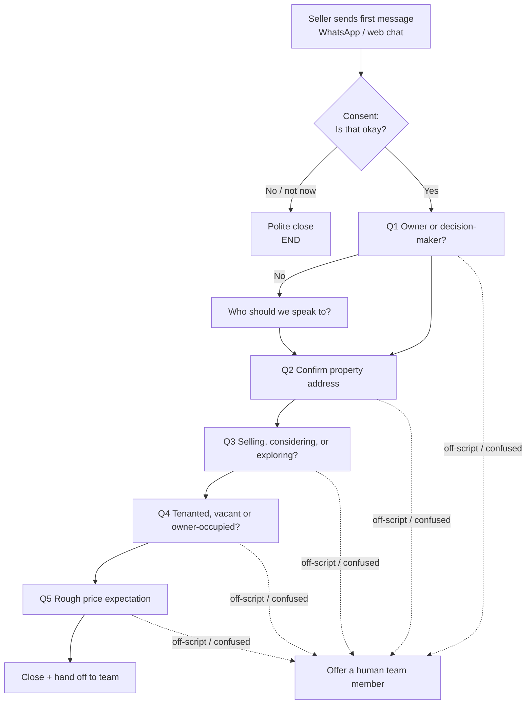

# Vendor AI: Seller Lead Qualification Agent

A conversational AI agent that qualifies property-seller leads over WhatsApp and web chat before a human calls them. Built inside **GoHighLevel (GHL) Conversation AI** for a UK property-investment marketing agency, February 2026.

> **Portfolio note.** The real build lives in a client's GHL account. This repository holds the design, the agent configuration, the CRM data model and a test harness, all rewritten with a fictional business and synthetic data. No client names, contacts or account IDs are included.

---

## The problem

Property investors buy directly from homeowners. Their ads produce seller enquiries faster than anyone can phone them, and many enquiries are not real sellers: people "just exploring", people with no authority to sell, or leads with no price in mind.

The team needed every enquiry answered within seconds, with time-wasters filtered out and the rest handed to a human **already briefed**.

## What the agent does

**Hard rules:** one question at a time, never give valuations, never book appointments, never mention automation, offer a human whenever the chat leaves the script.

## Repository contents

| Path | What it is |
|---|---|
| [`agent/v1-qualification-script.md`](agent/v1-qualification-script.md) | The original question flow and rules I wrote |
| [`agent/system-prompt.md`](agent/system-prompt.md) | Final single-prompt version used in GHL Conversation AI |
| [`agent/ghl-workflow-spec.md`](agent/ghl-workflow-spec.md) | The multi-node workflow version, node by node |
| [`docs/01-problem-and-requirements.md`](docs/01-problem-and-requirements.md) | Users, requirements, success criteria |
| [`docs/02-architecture.md`](docs/02-architecture.md) | System context: GHL, CRM objects, handoff, planned sync |
| [`docs/03-decisions.md`](docs/03-decisions.md) | Architecture decision records (why it was built this way) |
| [`docs/04-data-model.md`](docs/04-data-model.md) | Property custom object, fields, pipeline, webhook upsert |
| [`docs/05-testing.md`](docs/05-testing.md) | Test plan and how to run the evaluation harness |
| [`docs/06-status-and-limitations.md`](docs/06-status-and-limitations.md) | What was built, what wasn't, what I'd do next |
| [`evals/`](evals/) | Python harness that runs synthetic seller conversations against the prompt and scores rule compliance |

## Tech

GoHighLevel Conversation AI · GHL Workflows · GHL Custom Objects · merge fields · Python 3.10+ · Anthropic API (evaluation harness only)

## My role

- Wrote the qualification flow, the question wording and the hard rules (see `agent/v1-qualification-script.md`).
- Designed the Property custom object and CRM identifiers for a future sync with an external deal-analysis app.
- Built and configured the Conversation AI workflow in GHL.
- Used ChatGPT to tighten the prompt wording and to plan the build steps, then decided which suggestions to adopt.
- Added the evaluation harness in November 2026 while preparing this portfolio (it is new work, not part of the original client build).

## Status

**Configured prototype.** The workflow was built and reported complete in GHL in February 2026. Live lead volumes and qualification rates are not published here. See [`docs/06-status-and-limitations.md`](docs/06-status-and-limitations.md).

## Licence

MIT. See [LICENSE](LICENSE).
