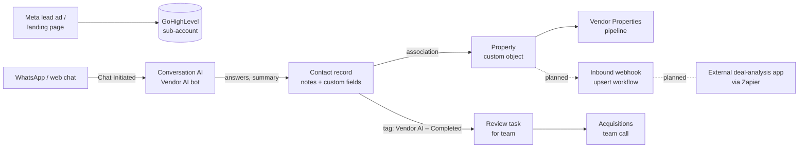

# 02: Architecture

## System context

Solid lines were built. Dotted lines were designed and prepared but not connected (see `06-status-and-limitations.md`).

## Components

| Component | Responsibility |
|---|---|
| **Conversation AI bot** | Runs the qualification conversation under the system prompt |
| **Contact record** | Holds the seller's answers and the AI-written call brief |
| **Property custom object** | One record per property, associated with the seller contact |
| **Vendor Properties pipeline** | Tracks each property from new lead to completion |
| **Review task workflow** | Makes sure no qualified lead sits uncalled |
| **Webhook upsert workflow** (planned) | Creates or updates a Property from an external app's payload, matched on `lovable_property_id` |

## Data flow for one lead

1. A seller messages the business. GHL fires **Chat Initiated**.
2. Vendor AI asks for consent, then the five questions, one at a time.
3. Answers are written to the contact. The bot closes and hands off.
4. A tag marks the chat complete. A task is created for the team.
5. The caller opens the contact, reads the brief and calls.

## Why GHL-native

See ADR-002 in `03-decisions.md`.
