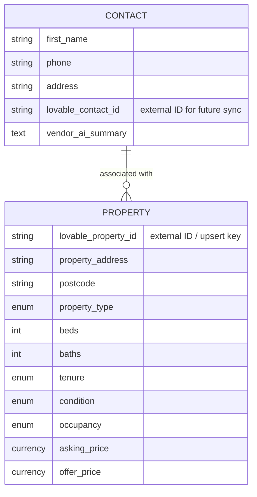

# 04: Data model: Property custom object

GHL's default model is contact-centric. A seller can own several properties, and the acquisitions process tracks the **property**, not the person. So a custom object was added.

## Entities



## Property object settings

| Setting | Value |
|---|---|
| Pipelines | Enabled |
| Associations | Enabled, with Contacts |
| Navigation | Sidebar relabelled "Contacts + Properties" via agency custom CSS |

## Pipeline: Vendor Properties

`New Lead → Analysing → Under Offer → Agreed → In Legals → Completed` (+ `Not Proceeding`)

## Field types

| Field | Type | Notes |
|---|---|---|
| `lovable_property_id` | Text | Blank until sync; upsert key |
| Property Address, Postcode | Text | |
| Property Type, Tenure, Condition, Occupancy | Dropdown | |
| Beds, Baths | Number | |
| Asking Price, Offer Price | Currency | Yield and ROCE deferred |

## Inbound webhook upsert (prepared shell)

```
Trigger: Inbound Webhook
1. Find Property where lovable_property_id = {{webhook.lovable_property_id}}
2. If found → Update Property   else → Create Property
3. Map address, postcode, type … from the webhook payload
4. Associate Property ↔ Contact {{webhook.ghl_contact_id}}
```

Built as an untested shell, waiting for the external app's payload format.

## Manual test

Before any automation: create a test contact, add a Property from **Associated Objects**, and check that it links to the contact, appears in the pipeline and moves between stages.
